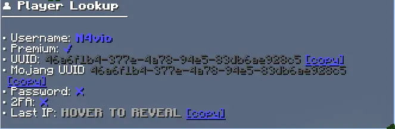

# User Lookup

## Lookup user profile
You can inspect the user profile using [/lookup profile](/general/commands.html#lookup-profile) command.

The command needs **both** permissions:
- `navauth.admin.playerlookup` (the `/lookup` command itself),
- `navauth.admin.playerlookup.profile` (the `profile` subcommand).

It shows the username, premium status, UUID, Mojang UUID and whether a password and 2FA are set.

